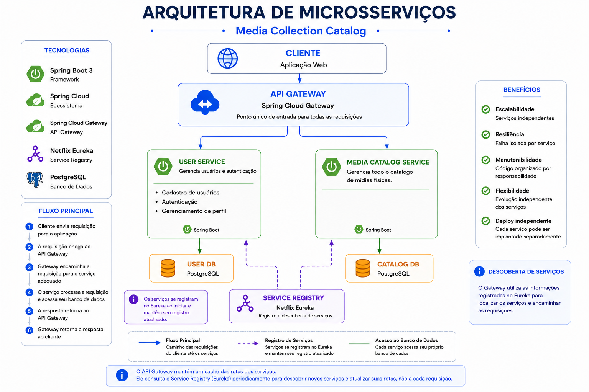

# 📚 Media Collection Catalog

> Plataforma para gerenciamento de coleções de mídias físicas, desenvolvida em Java e Spring Boot, atualmente em evolução de uma arquitetura monolítica para microsserviços.

---
## 🏛️ Sobre a Plataforma

O Media Collection Catalog é uma plataforma voltada para o gerenciamento de coleções físicas, permitindo o cadastro e a organização de diferentes tipos de itens, como CDs, vinis, fitas K7, DVDs e Blu-rays. A arquitetura do projeto foi concebida para permitir a expansão do domínio, possibilitando a inclusão de novos tipos de itens colecionáveis no futuro, como livros, histórias em quadrinhos e outros itens colecionáveis.

O projeto foi concebido inicialmente como uma aplicação monolítica para estudo e prática de conceitos fundamentais de desenvolvimento backend com Java e Spring Boot, incluindo modelagem de domínio, arquitetura orientada a domínio (DDD), mapeamento de dados, persistência com JPA/Hibernate e documentação de APIs.

Atualmente, a solução está em processo de evolução para uma arquitetura baseada em microsserviços, seguindo uma abordagem incremental e orientada ao domínio. A primeira etapa dessa evolução resultou na separação do sistema em dois serviços principais: o Media Catalog Service, responsável pelo gerenciamento do catálogo de mídias, e o User Service, responsável pelo gerenciamento de usuários e autenticação.

A solução também conta com autenticação baseada em JWT, utilizando Spring Security e OAuth2 Resource Server para proteção dos recursos do catálogo. A implementação permite identificar o usuário autenticado e associar as mídias cadastradas ao respectivo usuário, além de controlar o acesso às operações de alteração e exclusão.

A arquitetura continua sendo evoluída gradualmente, com a adoção de componentes como Service Registry, API Gateway e comunicação entre serviços, buscando construir uma plataforma escalável, organizada e de fácil manutenção.

Essa estratégia permite demonstrar não apenas a implementação de funcionalidades, mas também a capacidade de projetar, evoluir e manter sistemas distribuídos seguindo boas práticas de arquitetura de software.

---

## 🏗️ Diagrama de Arquitetura

A imagem abaixo representa a visão atual da arquitetura da plataforma e sua evolução para uma abordagem baseada em microsserviços. 

Atualmente, a solução está estruturada em dois serviços principais:

* **User Service:** responsável pelo gerenciamento de usuários e autenticação.
* **Media Catalog Service:** responsável pelo gerenciamento do catálogo de mídias físicas.

Os serviços utilizam um **Service Registry**, implementado com Spring Cloud Netflix Eureka, para registro e descoberta dos microsserviços.

A arquitetura também prevê a implementação de um **API Gateway**, que futuramente será utilizado como ponto único de entrada para as requisições da aplicação, permitindo centralizar o acesso aos diferentes serviços.


<div  align="center">
  
</div>

---

## 🧩 Microsserviços

O projeto está sendo evoluído para uma arquitetura baseada em microsserviços, com o objetivo de melhorar a organização do domínio, a separação de responsabilidades e permitir a evolução independente dos serviços.

Atualmente, a solução está estruturada em dois microsserviços principais:

* **User Service:** responsável pelo gerenciamento de usuários e autenticação, incluindo a geração dos tokens JWT utilizados para autenticar as requisições.

* **Media Catalog Service:** responsável pelo gerenciamento do catálogo de mídias físicas, incluindo CDs, vinis, K7s, DVDs, Blu-rays, artistas e diretores. O serviço também controla a associação das mídias aos usuários autenticados e as permissões de alteração e exclusão.

A comunicação e a infraestrutura da arquitetura estão sendo estruturadas de forma incremental, utilizando componentes como:

* **Service Registry:** responsável pelo registro e descoberta dos serviços disponíveis, utilizando Spring Cloud Netflix Eureka.
* **API Gateway:** previsto como ponto único de entrada para as requisições da aplicação.
* **Bancos de dados independentes:** cada microsserviço possui sua própria base de dados, garantindo maior autonomia e isolamento entre os domínios.

A arquitetura foi planejada de forma incremental, permitindo a inclusão de novos serviços e componentes conforme a evolução do projeto.

---

## 1. 🛠️ Tecnologias

As tecnologias utilizadas no desenvolvimento do projeto foram escolhidas com foco em boas práticas de desenvolvimento backend, organização de código, escalabilidade e manutenção da aplicação.

### Backend

* **Java 21** — Linguagem principal utilizada no desenvolvimento da aplicação.
* **Spring Boot 3.5.12** — Framework utilizado para criação da API REST e gerenciamento da aplicação.
* **Spring Data JPA / Hibernate** — Persistência e mapeamento objeto-relacional das entidades.
* **Spring Validation** — Validação dos dados recebidos pelas requisições.
* **Lombok** — Redução de código repetitivo através da geração automática de métodos.
* **MapStruct** — Conversão entre entidades e DTOs de forma segura e performática.
* **Maven** — Gerenciamento de dependências e configuração do projeto.

### Banco de Dados

* **PostgreSQL** — Banco de dados relacional utilizado para armazenamento das informações.
* **Flyway** — Controle de versionamento e migração do banco de dados.

### Ferramentas de Desenvolvimento

* **Git / GitHub** — Controle de versão e hospedagem do código-fonte.
* **Docker** — Tecnologia utilizada para futura containerização das aplicações e padronização do ambiente.
* **IntelliJ IDEA** — Ambiente de desenvolvimento utilizado.
* **Postman** — Testes e validação das APIs REST.
* **Swagger / OpenAPI** — Documentação e testes dos endpoints da API.

### Arquitetura e Comunicação

* **Microsserviços** — Arquitetura adotada para separação de responsabilidades e evolução independente dos serviços.
* **Spring Cloud** — Ecossistema utilizado para recursos de aplicações distribuídas.
* **Spring Cloud Netflix Eureka** — Service Registry utilizado para registro e descoberta dos microsserviços.
* **Spring Security** — Framework utilizado para autenticação e proteção dos recursos.
* **OAuth2 Resource Server** — Configuração utilizada para validação e proteção dos endpoints através de tokens JWT.
* **JWT** — Autenticação baseada em tokens utilizada para identificação dos usuários entre os serviços.
* **OpenFeign** — Comunicação síncrona entre serviços prevista para a evolução da arquitetura.

#### Tecnologias previstas para evolução da arquitetura

* **API Gateway** — Componente previsto para centralizar o acesso aos microsserviços.

### Mensageria

* **RabbitMQ** — Tecnologia prevista para comunicação assíncrona entre os serviços através de filas de mensagens.

---

## 🗺️ Roadmap

Evoluções e etapas do projeto:

- [x] Desenvolvimento da API REST para gerenciamento do catálogo de mídias.
- [x] Implementação das entidades e relacionamentos do domínio.
- [x] Criação de DTOs e mapeamentos utilizando MapStruct.
- [x] Implementação de validações e tratamento de exceções.
- [x] Migração da arquitetura monolítica para microsserviços.
- [x] Criação do User Service para gerenciamento de usuários.
- [x] Implementação de autenticação utilizando Spring Security e JWT.
- [x] Proteção dos endpoints do Media Catalog Service com OAuth2 Resource Server.
- [x] Identificação do usuário autenticado através do JWT.
- [x] Associação das mídias cadastradas ao usuário autenticado.
- [x] Implementação de controle de propriedade para alteração e exclusão de mídias.
- [x] Implementação do Service Registry para descoberta dos serviços utilizando Eureka.
- [ ] Implementação do API Gateway.
- [x] Comunicação entre serviços utilizando OpenFeign.
- [ ] Comunicação assíncrona entre serviços utilizando RabbitMQ.
- [ ] Containerização da aplicação utilizando Docker.
- [ ] Orquestração dos serviços utilizando Kubernetes.

---

## 🚀 Como executar a aplicação

### Pré-requisitos

Antes de executar o projeto, certifique-se de possuir:

* **Java 21** — Ambiente de execução das aplicações.
* **PostgreSQL** — Banco de dados utilizado pelos microsserviços.
* **Git** — Para clonar o repositório.

### Configuração dos bancos de dados

Cada microsserviço possui sua própria base de dados, seguindo o princípio de isolamento de dados entre os serviços.

Crie os bancos de dados PostgreSQL:

* `collection_catalog_db` — utilizado pelo Media Catalog Service.
* `user_service_db` — utilizado pelo User Service.

As informações de conexão devem ser configuradas no arquivo `application.properties` de cada microsserviço.

Exemplo:

```properties
spring.datasource.url=jdbc:postgresql://localhost:5432/NOME_DO_BANCO
spring.datasource.username=SEU_LOGIN
spring.datasource.password=SUA_SENHA
```

> O projeto possui suporte ao **Flyway Migration** para versionamento da estrutura dos bancos de dados.

### Clonando o repositório

```bash
git clone https://github.com/clrangel/media-collection-catalog.git
```

Acesse o diretório:

```bash
cd media-collection-catalog
```

### Executando a aplicação

#### Windows

```bash
mvnw.cmd spring-boot:run
```

#### Linux/Mac

```bash
./mvnw spring-boot:run
```

Após a inicialização, a API estará disponível em:

```text
http://localhost:8080
```

### Documentação da API

A documentação dos endpoints pode ser acessada através do Swagger/OpenAPI:

```text
http://localhost:8080/swagger-ui/index.html
```


